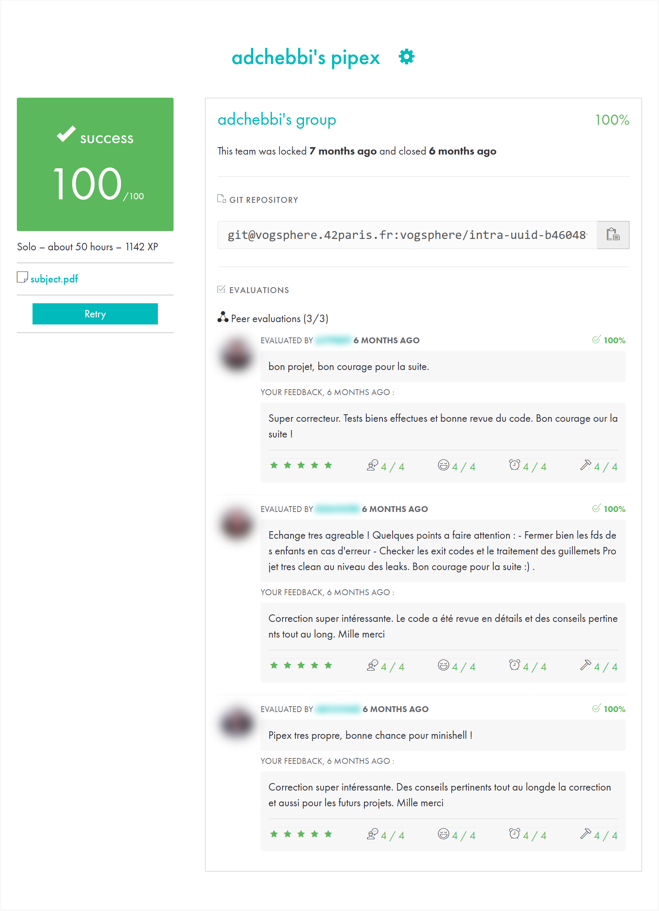

*This project has been created as part of the 42 curriculum by adchebbi.*

# pipex

> Reproduces the shell pipeline `< file1 cmd1 | cmd2 > file2` in C with `pipe`, `fork`, `dup2` and `execve`,
> including `PATH` resolution and shell-like exit codes.

   

```console
$ ./pipex infile "grep a1" "wc -w" outfile && cat outfile
4
$ < infile grep a1 | wc -w
4
```

## Highlights

- **Two child processes connected by a pipe**: stdin of `cmd1` comes from `file1`, stdout of `cmd2` goes to
  `file2`, and each process closes the pipe ends it does not use.
- **Command resolution**: looks up each command in the `PATH` environment variable, or uses it directly if it
  is given as a path.
- **Shell-like errors**: `127` when a command is not found, `1` when a file cannot be opened. Errors are
  printed on stderr.
- **Leak-free**: Valgrind reports no leaks.

## Build & Run

```bash
make
./pipex file1 "cmd1 args" "cmd2 args" file2
```

| Argument | Role |
|---|---|
| `file1` | input file, becomes stdin of `cmd1` |
| `cmd1` | first command with its arguments |
| `cmd2` | second command with its arguments |
| `file2` | output file (created or truncated), receives stdout of `cmd2` |

```bash
./pipex infile "ls -l" "wc -l" outfile      # same as: < infile ls -l | wc -l > outfile
./pipex infile "grep a1" "wc -w" outfile    # same as: < infile grep a1 | wc -w > outfile
```

## How it works

```
            pipe(fd)
   ┌───────────────────────────┐
file1 ─▶ [child 1] cmd1 ─▶ fd[1] ═══ fd[0] ─▶ [child 2] cmd2 ─▶ file2
         dup2(file1, STDIN)                    dup2(fd[0], STDIN)
         dup2(fd[1], STDOUT)                   dup2(file2, STDOUT)
         execve(cmd1)                          execve(cmd2)
   parent: closes both pipe ends, waitpid() on both children, returns the status of cmd2
```

## Testing

Compared with the real shell on the same inputs:

| Case | Result |
|---|---|
| `"grep a1" "wc -w"`, `"ls -l" "wc -l"` | same output as Bash ✅ |
| unknown command | `command not found`, exit 127 ✅ |
| unreadable or missing input file | error on stderr, exit 1 |
| output file without permission | `Permission denied`, exit 1 ✅ |
| wrong number of arguments | usage message, exit 1 ✅ |
| Valgrind | no leaks ✅ |

## Project structure

```
.
├── Makefile
├── include/
├── libft/        # personal C library
└── srcs/
    ├── main.c    # argument check, file opening, process orchestration
    ├── pipex.c   # child processes, pipe and dup2 wiring
    ├── path.c    # PATH lookup for each command
    └── utils.c   # error exits, command splitting, cleanup
```

## Resources

- Man pages: `pipe(2)`, `fork(2)`, `dup2(2)`, `execve(2)`, `waitpid(2)`, `access(2)`
- [Pipe: an inter-process communication method](https://www.codequoi.com/en/pipe-an-inter-process-communication-method/), codequoi
- [Communicating between processes (using pipes) in C](https://youtu.be/Mqb2dVRe0uo), CodeVault

### AI usage

AI (Claude) was used to write this README, to validate the implementation logic, and to track project
progress and development steps.

## 42 evaluation

Validated at **100/100** by 3 peer evaluations.
Other students' names and photos are blurred.

<p align="center"></p>

## Author

**Adem Chebbi** ([@ademchbb](https://github.com/ademchbb)), 42 login `adchebbi`
